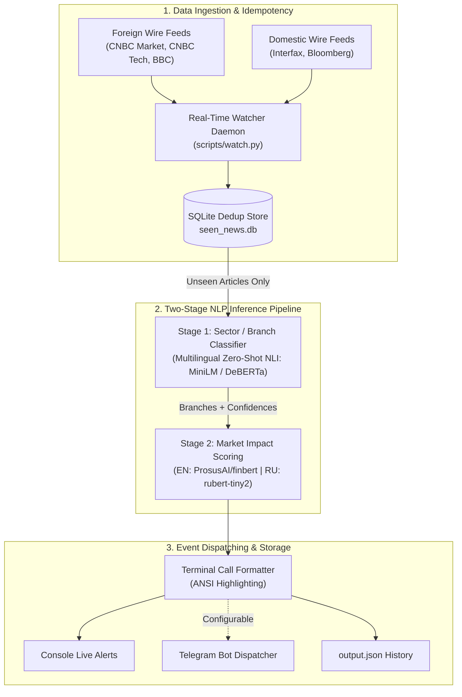

# Real-Time News Intelligence & Sector Impact Classifier

[](https://www.python.org/)
[](https://opensource.org/licenses/MIT)
[](https://huggingface.co/)

Автономный сервис потокового мониторинга и анализа международных новостных агентств в режиме реального времени. Система фильтрует информационный шум, классифицирует события по 10 отраслям экономики и оценивает вектор их рыночного влияния (**Positive / Negative / Neutral**) с помощью каскадного NLP-пайплайна.

---

## Архитектура системы



---

## Ключевые инженерные решения и Trade-offs

1. **Двухуровневый каскад (Two-Stage Separation of Concerns):**
   * **Stage 1 (Отрасль):** Мультиязычный Zero-Shot NLI (`MoritzLaurer/multilingual-MiniLMv2-L6-mnli-xnli` / `mDeBERTa-v3`). Позволяет динамически настраивать таксономию отраслей в `config.yaml` без ручной разметки обучающего датасета.
   * **Stage 2 (Влияние):** Доменно-специфичные модели (`ProsusAI/finbert` для английского и `rubert-tiny2-financial-sentiment` для русского). В отличие от общих сентимент-моделей, они обучены на финансовом контексте и понимают, что повышение ставки или падение выручки — это негативные сигналы.
2. **RSS Polling вместо жестко лимитированных REST API:**
   * Публичные бесплатные REST API накладывают лимит (например, 100 запросов/день), делая невозможным частый опрос. RSS-потоки позволяют опрашивать ленту каждые 60–120 секунд с нулевыми затратами.
3. **Идемпотентность и дедупликация (Idempotency Layer):**
   * Каждый заголовок и URL хешируются и проверяются по SQLite-базе `seen_news.db`. Тяжелый инференс нейросетей запускается только для новых событий.
4. **Гибридный режим (Graceful Fallback):**
   * При отсутствии GPU или в тестовом окружении без установленных тяжелых весов моделей система автоматически переключается на встроенный rule-based keyword matcher.

---

## 10 целевых отраслей

Таксономия определена в `data/branches.json` и `config.yaml`:
* `energy` — Нефтегаз, электроэнергетика, АЭС, топливо
* `finance` — Банки, центробанки, процентные ставки, инфляция, биржи
* `tech` — ИИ, полупроводники, ПО, облачные сервисы, кибербезопасность
* `agro` — Сельское хозяйство, зерно, удобрения
* `logistics` — Перевозки, порты, судоходство, авиалинии
* `defense` — ВПК, оборонная промышленность, военные заказы
* `pharma` — Фармацевтика, биотехнологии, медицина
* `metals` — Металлургия, золото, медь, сырьевые товары
* `realty` — Недвижимость, девелопмент, ипотечный рынок
* `retail` — Розничная торговля, маркетплейсы, e-commerce

---


### 1. Запуск персонального aka Bloomberg-терминала в реальном времени

```bash
# Форекс
python scripts/watch.py --topic forex --max-age 30

# Режим "Чистый старт" (синхронизирует текущую базу и ждет ТОЛЬКО новые релизы в реальном времени):
python scripts/watch.py --topic forex --clean-start

# Торговый режим без шума (только реальные сигналы BULLISH/BEARISH, без нейтральной аналитики):
python scripts/watch.py --topic forex --actionable-only --sound

# Мониторинг криптовалютного/финтех рынка (финансы + технологии):
python scripts/watch.py --topic crypto

# Сырьевой рынок (энергетика, металлы, агро):
python scripts/watch.py --topic commodities

# Быстрый тестовый запуск на демонстрационных данных (1 цикл):
python scripts/watch.py --fast --offline --once --topic forex

# Кастомный интервал опроса (например, опрос каждые 15 секунд):
python scripts/watch.py --interval 15 --limit 10
```

---

## Пример вывода сигнала в терминале

```text
=================================================================
🟢 [CALL: POSITIVE / BULLISH] | 2026-09-30 11:41:24 | Source: CNBC
🕒 Published: Wed, 30 Sep 2026 11:35:00 GMT
📌 Title:     Nvidia unveils next-generation AI chip platform as tech stocks rally
🇷🇺 Перевод:   Nvidia представляет платформу чипов искусственного интеллекта следующего поколения на фоне роста акций техкомпаний
🏢 Branch:    TECH (95%)
📊 Impact:    POSITIVE (score: +0.94, magnitude: HIGH)
💡 Reason:    finbert: positive (pos=0.94, neg=0.02, neu=0.04)
🔗 Link:      https://www.cnbc.com/demo/4
=================================================================
```

---

## Структура репозитория

```
news_classifier/
├── config.yaml               # Конфигурация фидов, моделей, перевода и порогов
├── requirements.txt          # Зависимости проекта
├── data/
│   ├── branches.json         # Определения и ключевые слова отраслей
│   └── seen_news.db          # База дедупликации (SQLite)
├── src/
│   ├── models.py             # Датаклассы (NewsItem, BranchHit, ImpactHit, ClassifiedNews)
│   ├── translate.py          # Автоматический перевод EN -> RU с кешированием и failover
│   ├── pipeline.py           # Конвейер объединения Ingestion -> Translation -> Stage 1 -> Stage 2
│   ├── ingest/               # Модули сбора новостей
│   │   ├── base.py           # Базовый абстрактный класс + определение языка
│   │   ├── foreign_rss.py    # CNBC & BBC коннектор с User-Agent
│   │   ├── bloomberg_rss.py  # Bloomberg RSS коннектор
│   │   └── interfax_rss.py   # Интерфакс коннектор
│   ├── classify/             # Классификаторы
│   │   ├── branch_classifier.py  # Stage 1: Multilingual Zero-Shot NLI + Fallback
│   │   └── impact_classifier.py  # Stage 2: FinBERT / RuSentiment + Fallback
│   ├── storage/
│   │   └── dedup.py          # SQLite хранилище дедупликации
│   └── alerts/
│       ├── formatter.py      # Красивый форматированный вывод алертов (время, перевод)
│       └── telegram_notifier.py # Telegram Bot API диспетчер с поддержкой HTML и перевода
├── scripts/
│   ├── watch.py              # Real-Time демон мониторинга
│   └── run_demo.py           # Одноразовый тестовый запуск
└── tests/
    ├── test_pipeline.py      # Тесты пайплайна
    ├── test_dedup.py         # Тесты хранилища дедупликации
    ├── test_translation_and_time.py # Тесты времени публикации и перевода
    ├── test_branch_filtering.py     # Тесты выбора тем и пресетов (forex/crypto/etc.)
    └── test_freshness.py            # Тесты отсечения старых новостей и бейджей свежести
```

---

## Подключение Telegram-уведомлений

Для активации отправки сигналов в Telegram:

1. Задайте переменные окружения:
   ```bash
   export TELEGRAM_BOT_TOKEN="ваш_токен"
   export TELEGRAM_CHAT_ID="ваш_chat_id"
   ```
2. Включите отправку в `config.yaml`:
   ```yaml
   watcher:
     enable_telegram: true
   ```
